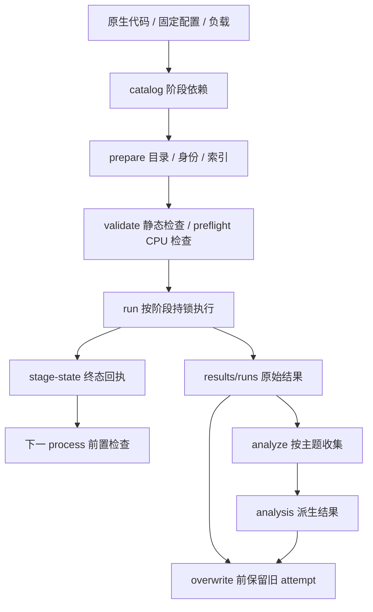

# 项目目录和执行关系

> 原生维护文档。实验定义以 `research/dsv4-flash0731/experiments/catalog.json` 为准。复现步骤见 [reproduction.md](reproduction.md)，产物分类见 [artifact-policy.md](artifact-policy.md)。

原生发布树包含：

```text
project/
├── AGENTS.md                       项目协议
├── progress.md                     当前工程进度与验证范围
├── README.md                       使用入口
├── requirements-vllm.lock.txt       固定推理依赖版本
├── activate-vllm.sh                 本项目环境激活
├── tools/                          复现、原生发布/迁移检查和 CPU 检查源码
├── doc/                            当前复现、目录、规则和路线图
└── research/dsv4-flash0731/
    ├── project_layout.py           显式路径解析、自动建目录
    ├── experiments/
    │   ├── catalog.json            唯一原生执行登记
    │   ├── architecture/configs/   架构固定配置
    │   ├── scenarios/              共用 configs/workloads 和任务语料
    │   └── scheduler/              调度 configs/workloads
    ├── scripts/                    架构运行/分析工具
    ├── doc/                        原生方法和协议
    ├── scenarios/{scripts,doc}/    共用运行器、容量/场景分析
    ├── long-context/{scripts,doc}/ 长上下文分析和检查
    ├── sessions/                   运行/评分/分析源码、协议、Notebook 模板
    └── scheduler/                  外置调度器、分析源码、协议、Notebook 模板
```

以下目录由运行创建，不作为原生源码提交：

```text
research/dsv4-flash0731/experiments/<主题>/process*/
    stage.json、实验描述 JSON        prepare 从 catalog 生成的索引
results/
├── setup/                         依赖清单和本次环境/模型身份
├── validation/                    静态检查与 CPU 预检报告
├── stage-state/                   运行/阶段终态和监督日志
├── runs/<语义实验ID>/             原始测量和源码/配置快照
├── analysis/<主题>/               派生分析、日志、doc 报告
├── packages/                      生成的源码包与 manifest
└── preserved/                     覆盖前旧运行、状态和分析
.venv-vllm/、.venv-analysis/、.cache/ 本机环境与缓存
```

`catalog.json` 是唯一需要维护的原生执行登记，configs/workloads/fixtures 是固定参数和负载。各 process 下的 stage.json 及实验描述 JSON 由 `prepare` 自动生成并标记 generated；不要同时手改 catalog 和索引。capacity、long-context、sessions 共享 `experiments/scenarios/` 中的输入，各主题分析统一读取 `results/runs/`。

catalog 包含 84 个定义、83 个完整可执行定义和 21 个阶段，可用 `python3 tools/reproduce.py list --json` 查询。`legacy_id` 和来源标识用于追溯，不要求历史归档在当前树中。随机种子、模型版本名称有实验意义，不因为形式像日期而改变。

## 执行和数据流



项目根和研究根从 `__file__` 定位；原生配置的 `${PROJECT_ROOT}`、`${MODEL_PATH}`、`${RUN_DIR}` 在加载时展开。模型默认 `~/models/dsv4-flash0731`，以 `DSV4_MODEL_PATH` 覆盖。运行解释器默认本项目 `.venv-vllm/bin/python`；有意使用外部兼容环境时可设置 `VLLM_PYTHON`。这两个环境变量的相对路径均以项目根定位。模型目录不保存实验结果。

Markdown 项目文档位于各级 `doc/`，根 AGENTS/progress/README 是协议和入口例外。任务语料中交给模型读取的 README/docs 属于原生 fixture，保持原路径和内容。Notebook 模板无执行输出；执行后的 Notebook 是生成物，应保存在 results 内。当前主 analyze 不自动执行旧绘图/Notebook 流水线。

必要的历史决策输入仍可保留在源码中，用于固定配对、阈值和研究协议；其来源 hash 不等于当前运行通过。历史专用 review_*decision、review_*confirm_plans 及固定数字检查需要相应历史 raw，不作为从零新运行的自动前提。旧结果、环境调查、报告、迁移清单和原始归档在项目外本地保留，不属于源码树。
